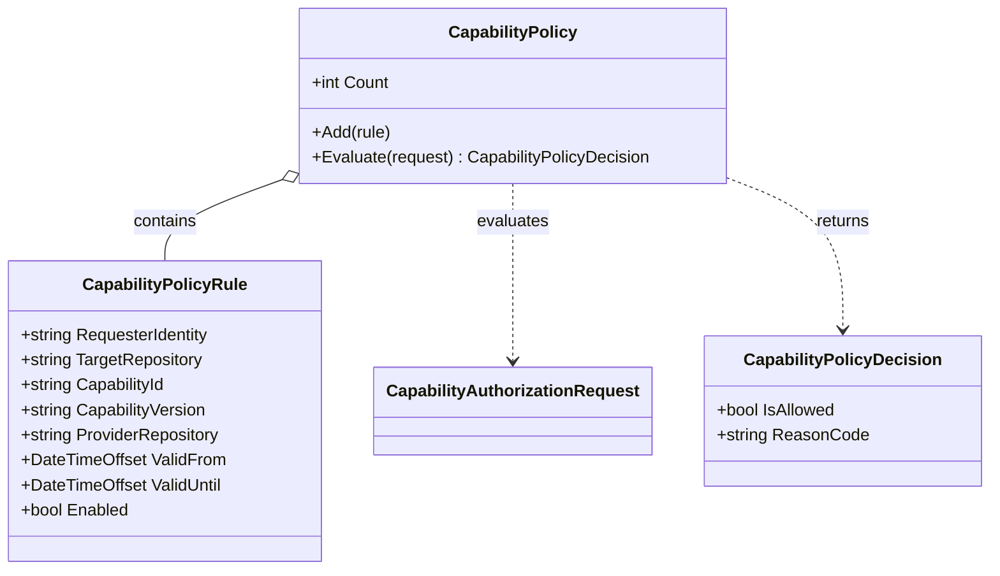

# CapabilityPolicy UML and Use Case

**Owner moniker:** The Singularity Workshop  
**Purpose:** make an explicit authorization decision before a capability request is dispatched.

## Use case

1. Parent coordinator identifies the authenticated requester and exact target.
2. CogA resolves a declared capability; CogB constructs a bounded request.
3. CogD evaluates the exact rule and time window.
4. A denial stops dispatch. An allow result still requires provider and CI controls.
