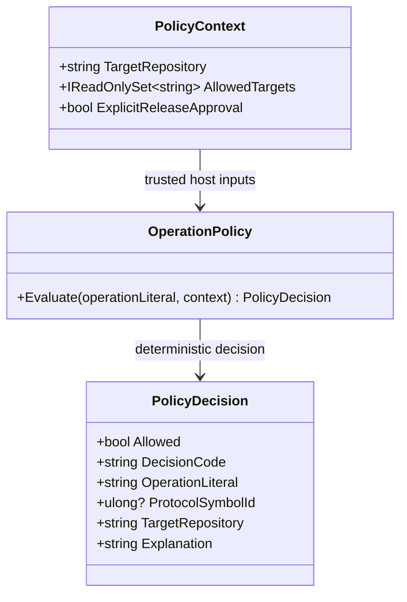

# OperationPolicy — UML Class Card and Use Case

**User moniker:** CogD Deterministic Vocabulary and Policy Gate

## Use case: resolve an operation literal

1. The host supplies the target allowlist and any release-approval fact.
2. `OperationPolicy` resolves only declared ProtocolAi symbols: `observe.status`, `test.noop`, and `publish.package`.
3. Missing context, disallowed targets, and unknown literals are denied.
4. `publish.package` remains denied by this prototype even when the approval flag is true.
5. The host still owns authorization and execution.

## Boundary

A policy decision is not a dispatch instruction and does not prove the target repository ran anything. Publishing remains disabled.
