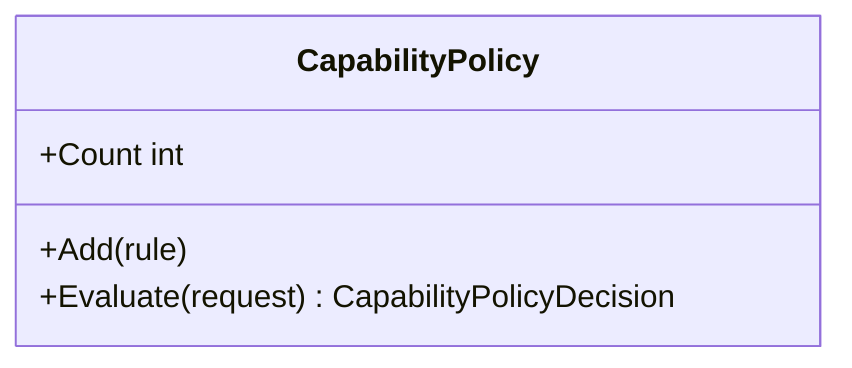

# CapabilityPolicy

**Owner moniker:** The Singularity Workshop  
**Purpose:** apply explicit exact-match, time-bounded, default-deny authorization rules before dispatch.

## Responsibility

Apply explicit exact-match, time-bounded, default-deny authorization rules before dispatch. The class provides a bounded, dependency-free control-plane primitive. It does not perform remote execution, grant implicit permission, or replace authoritative provider evidence.

## UML class card

For the focused class diagram and use case, see [CapabilityPolicy UML](../../docs/UML/CapabilityPolicyUML.md).
